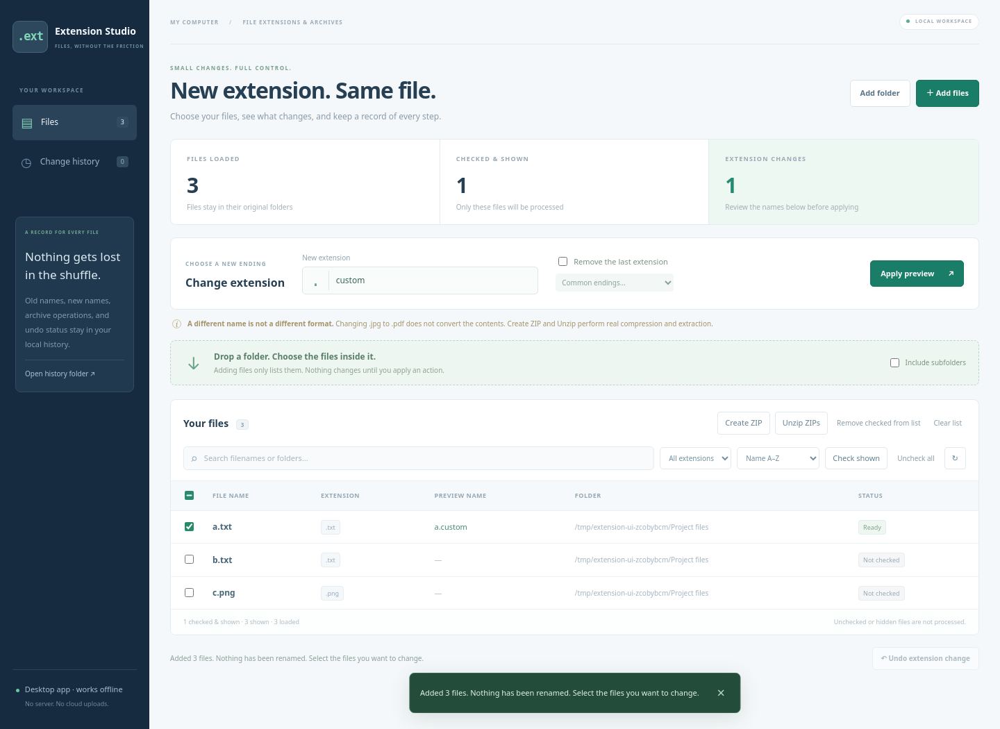
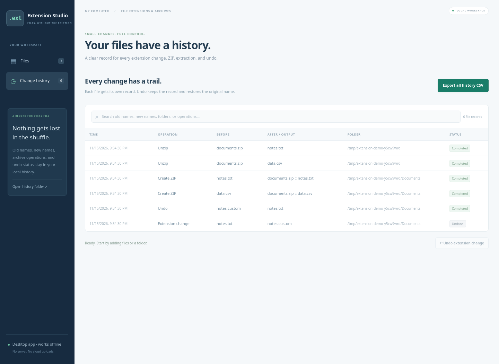

# File Extension Changer

A Python desktop application with a local HTML/CSS/JavaScript interface. Select files from a folder, change only the checked files' extensions, create verified ZIPs, extract ZIP archives, and keep a persistent record for every processed file.

The interface runs inside a **native PySide6 desktop window** using Qt WebEngine and QWebChannel. It does **not** start a website, localhost server, browser tab, or cloud upload.



## Install and run

Requires Python 3.10+ and a desktop operating system supported by PySide6.

Download **Code → Download ZIP** from this repository and extract it, or clone it:

```bash
git clone https://github.com/nge9/File-extensions-changer-.git
cd File-extensions-changer-
```

Open a terminal in the folder containing `main.py`:

```bash
python -m pip install -r requirements.txt
python main.py
```

Use `python3` if your system requires it, or `py -3` on Windows. Installing PySide6 downloads a native desktop runtime and can take a few minutes. After installation, Windows users can also double-click `start.bat`.

Keep the full repository together: the app needs the `ui` folder and its Python modules. Instructions are kept here; the source code contains no comments or docstrings.

## Choose specific files inside a folder

1. Click **Add folder**, **Add files**, or drop a local folder/files into the window. Adding a folder lists its ordinary files. It does not upload, move, or rename them.
2. Enable **Include subfolders** before adding a folder if you also want nested files. Changing this option does not rescan a previously loaded folder automatically.
3. **Files load unchecked.** Check individual file rows, use the header checkbox, or click **Check shown**.
4. Use the name/folder search and extension filter to narrow the list.

**Only checked files currently shown by the filters are processed.** Checked files hidden by a filter are excluded. The count above the list shows exactly how many checked files are shown. Unchecked files remain untouched.

**Remove checked from list**, **Uncheck all**, and **Clear list** only change the selection. They do not delete files or history. Up to 10,000 distinct files can be loaded per window. Symbolic links and special files are skipped or rejected.

## Change extensions

1. Check the files you want to change.
2. Enter a custom extension, such as `txt`, `.pdf`, `myformat`, or `tar.gz`. A leading dot is optional. Common choices are also available in the dropdown.
3. To remove an extension, explicitly check **Remove the last extension**. Leaving the input blank by itself does nothing.
4. Review the **Preview name** and **Status** columns, then click **Apply preview** and confirm.

A conflicting or invalid filename disables the entire extension-change batch. Existing files are not overwritten. The target field and filters reset after a successful extension change or undo. Files stay in their original directories.

**An extension change is a rename, not a format conversion.** Renaming `photo.jpg` to `photo.pdf` leaves JPEG data inside; it does not create a PDF. Likewise, renaming a file to `.zip` does not compress it. Use **Create ZIP** for real compression and a suitable converter for other format conversions.

The last suffix is replaced: `archive.tar.gz` with target `zip` becomes `archive.tar.zip`. Hidden names such as `.env` have no extension under Python's filename rules. Custom extensions still have to form valid filenames; path separators, reserved names, control characters, and other characters invalid on Windows are rejected.

## ZIP and unzip

### Create ZIP

Check the visible files and click **Create ZIP**. Choose a **new** destination filename. The app compresses with ZIP Deflate, verifies archived file contents against SHA-256 digests, records each file, and publishes the completed archive. Originals are kept.

The created ZIP is added to the file list unchecked, ready to select for extraction. Paths inside the ZIP are relative to the selected files' common parent, preserving subfolder structure. Selecting files from distant directories can therefore include those parent directory names inside the archive. Creating a single ZIP from files on different Windows drive volumes is not supported.

### Unzip ZIPs

Check one or more valid ZIP archives and click **Unzip ZIPs**. Choose an output parent folder. Each ZIP is extracted into its own new folder, such as `photos-extracted-12ab34cd`. Original ZIPs are kept; existing folders and files are not overwritten. The result dialog offers **Open output folder**.

The app verifies extracted file bytes and rejects path traversal, absolute/drive paths, symbolic links, special filesystem entries, duplicate/case-conflicting paths, and password-protected ZIPs. It supports at most 10,000 entries and 10 GiB of declared uncompressed data per archive, and checks available disk space. Stored and Deflate ZIP compression are supported. Other compression methods or corrupt archives produce an error and no published partial extraction folder.

If several valid ZIPs are selected and one fails during extraction, successful extractions remain available and the report lists the failed ZIPs. Basic file contents and archive-relative structure are the focus; full permissions, ACLs, extended attributes, hard-link relationships, and original extraction timestamps are not preserved. ZIP64 is enabled, but very large archives have not been tested at that size. Empty directories in an existing ZIP are preserved; ZIP creation works from selected regular files rather than empty folder entries.

ZIP creation/extraction never deletes the source files. They are separate operations from extension renaming.

## A record for every file



The **Change history** page shows one row for every processed file, including:

- Time and operation: extension change, undo, ZIP creation, or extraction.
- Original name and resulting name/archive member.
- Source folder and full source/destination paths in tooltips.
- Completion, undo, interruption, or recovery status.

History persists after the application closes. Undo retains the earlier change record and adds an undo record, rather than erasing what happened. ZIP and extraction records also include member paths, sizes, and SHA-256 digests in their JSON logs.

The page displays the latest 1,000 file records. **Export all history CSV** exports every record, including older ones. Choose a new CSV filename: exports do not overwrite an existing file. Names that could be interpreted as spreadsheet formulas are prefixed with an apostrophe in CSV display fields.

History is stored in Qt's local per-user application-data location under `UsefulTools/FileExtensionChanger/history` (the exact platform path can vary). **Open history folder** opens the actual location. Archive-operation logs are in its `archive-operations` subfolder. The logs contain paths and metadata, not source file contents. Clearing the loaded file list does not clear these logs.

Only one normal application window can use the default history location at a time. Back up this directory if you want to retain the audit trail. Loaded file selections are session-only; the history is persistent.

## Undo and recovery

**Undo extension change** restores the last completed extension-change batch, including after restarting the app. It does not delete created ZIPs or extracted copies, and it does not undo archive operations.

The rename engine records the plan before changing filenames, stages names to support swaps/cycles, and uses non-replacing filesystem moves. It checks recorded file identity, size, and modification time before undo or recovery. These metadata checks are not cryptographic content verification. Undo stops when it detects a changed/replaced file or an occupied original name.

If an extension change is interrupted, **Recover original names** appears. If another unrelated file now occupies an original name, move that unrelated file elsewhere before recovery. Do not manually rename the `.bulk-rename-...tmp` files unless you are deliberately recovering from the log.

ZIP operations stage output before publishing it. A forced process termination can leave a `.zip-...partial` file or `.unzip-...` temporary directory in the chosen destination. A log marked **Prepared — inspect output** may indicate a stop around publication; inspect the paths before deleting leftovers. Original input files are retained by archive operations.

Close files in other programs while changing extensions, undoing, or archiving them. The app checks changes but cannot lock out every other writer or guarantee recovery from disk corruption, power loss, or continuous concurrent modifications. Keep backups of important data.

## Tests

The 50 engine, session, and archive tests use Python's standard library:

```bash
python -m unittest discover -s tests -v
```

The native desktop integration test requires the desktop dependency:

```bash
python tests/gui_smoke.py
```

It exercises the actual HTML interface and Python bridge: folder selection, unchecked defaults, changing only a checked file, per-file history, undo, ZIP creation, extraction, CSV export, and a native file-drop event. Fixtures are generated in temporary directories. On headless Linux it uses Qt's offscreen mode. File-picker selections and drag/drop events are automated; physical mouse interaction was not manually tested.

Tested locally with Python 3.12 and PySide6 6.12 on Linux. The workflow checks the standard-library suite on Windows, macOS and Linux with Python 3.10/3.13, plus the native HTML UI flow on Linux. Windows/macOS desktop rendering has not been tested locally.

If Linux reports a missing `libEGL.so.1`, install the graphics libraries through your distribution's package manager. For Ubuntu/Debian:

```bash
sudo apt-get update
sudo apt-get install libegl1 libgl1 libopengl0 libgbm1 libnss3 libxkbcommon0
```

## Project files

- `main.py` — native desktop window, HTML bridge, dialogs and background worker.
- `service.py` — checked-file sessions, per-file history, and archive integration.
- `renamer.py` — rename planning, conflict checks, undo and recovery.
- `archives.py` — ZIP compression, verification and safe extraction.
- `ui/` — local HTML, CSS, JavaScript and app icon.
- `tests/` — behavior tests and native UI smoke test.

## License

MIT. See [LICENSE](LICENSE).
